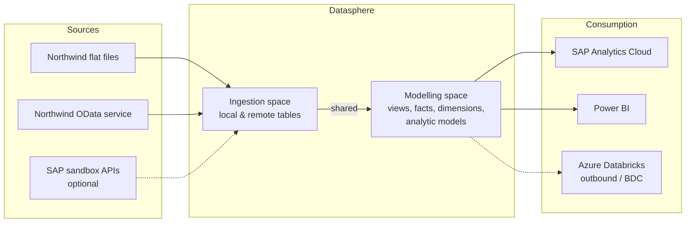
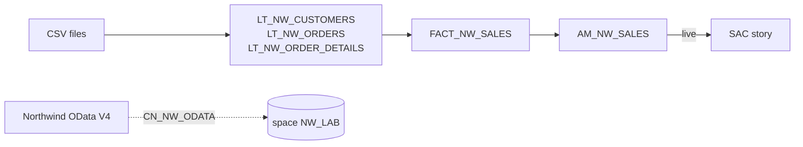

# Architecture

Living view of the solution; updated as each unit adds objects.

## Target (provisional)

## Current state

Unit 01 in progress, built in the own space `NW_LAB` (2 GB disk / 1 GB memory, time data
1900–2050). Deployed: local tables `LT_NW_CUSTOMERS`, `LT_NW_ORDERS`,
`LT_NW_ORDER_DETAILS`; fact view `FACT_NW_SALES`; analytic model `AM_NW_SALES`;
connection `CN_NW_ODATA` (Generic OData V4, validated). Consumed live by the SAC story
`Northwind Sales Overview`. Next: remote table `RT_NW_ORDERS` replacing `LT_NW_ORDERS`.

