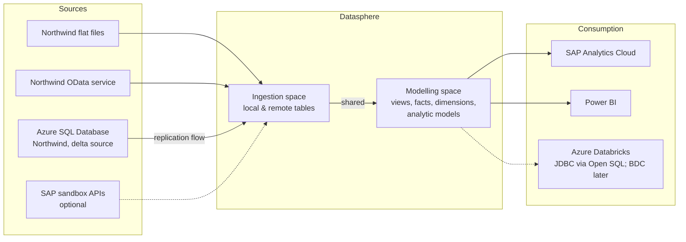
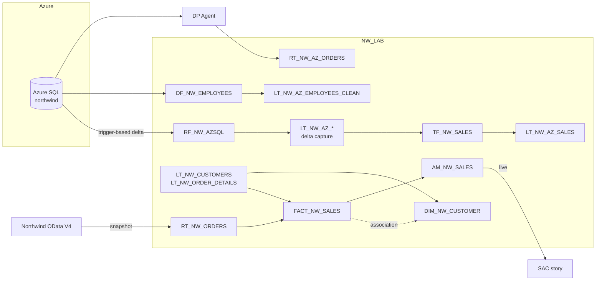
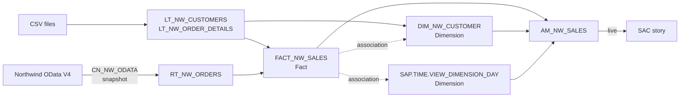

# Architecture

Living view of the solution; updated as each unit adds objects.

## Target

## Current state

After Phase C (November 2026), still in the one space `NW_LAB`; the split into an ingestion space
and a modelling space is Phase D. Phase A's star schema stays as v1. Details and the layer
diagram: [Phase C summary](phases/phase-c-modelling.md).

| Layer | Objects |
| ----- | ------- |
| Inbound | Everything from Phase B (`LT_NW_AZ_*`, `LT_NW_AZ_SALES`, `LT_NW_AZ_EMPLOYEES_CLEAN`, remote tables, `Country_Master_Data_by_DCA`) and Phase A's CSV tables; `LT_NW_CATEGORY_TEXTS` (synthetic) |
| Harmonized | `V_NW_PRODUCT`, `V_NW_PRODUCT_RANK`, `V_NW_CUSTOMER_ORDERS`, `V_NW_SALES_UNION`, `V_NW_COUNTRY_NAMES`, `V_S4_BP_BY_CATEGORY` (persisted), `IL_NW_COUNTRY` |
| Semantic | `FACT_NW_ORDER_LINE`; `DIM_NW_PRODUCT`, `DIM_NW_CATEGORY`, `DIM_NW_SUPPLIER`, `DIM_NW_EMPLOYEE`, `DIM_NW_CUSTOMER_AZ`, `DIM_NW_COUNTRY`; `TXT_NW_CATEGORY`; `HIER_NW_EMPLOYEE`, `HIER_NW_CUSTOMER_DIR`, `DIM_NW_CUST_GROUP`, `DIM_NW_CUST_HIER_DIR`; `SAP.TIME.*` |
| Consumption | `AM_NW_ORDER_LINE` (preview only so far); v1: `AM_NW_SALES` → SAC story `Northwind Sales Overview` |

## After Phase B

After Phase B (2026-10-29), still in the one space `NW_LAB` (2 GB disk / 1 GB memory). Phase A's
star schema is unchanged; Phase B added every ingestion path next to it. Objects and columns:
[`data-dictionary.md`](data-dictionary.md).

| Layer | Objects |
| ----- | ------- |
| Sources | Northwind CSV files; Northwind OData V4 (`CN_NW_ODATA`); Azure SQL Database `northwind` (`CN_NW_AZSQL`, direct for flows, DP Agent for remote tables); SAP S/4HANA Cloud sandbox (`CN_NW_S4SBX`); Data Marketplace |
| Ingestion | Phase A: `LT_NW_CUSTOMERS`, `LT_NW_ORDER_DETAILS`, `RT_NW_ORDERS` (daily snapshot). Phase B: `LT_NW_AZ_*` (8 tables, delta capture, from `RF_NW_AZSQL`); `RT_NW_AZ_ORDERS`; `RT_S4_BUSINESS_PARTNER`; `Country_Master_Data_by_DCA`; Open SQL schema `NW_LAB#ETL` |
| Transformation | `TF_NW_SALES` → `LT_NW_AZ_SALES` (order lines with revenue, delta); `DF_NW_EMPLOYEES` → `LT_NW_AZ_EMPLOYEES_CLEAN` (Python cleanup); `V_NW_SALES_VS_TARGET` (actuals vs. Open SQL targets) |
| Semantic | `FACT_NW_SALES` (Fact); `DIM_NW_CUSTOMER` (Dimension); `SAP.TIME.*` (generated time data) |
| Consumption | `AM_NW_SALES` (analytic model) → SAC story `Northwind Sales Overview` |

Solid arrows are data flows; dotted arrows are associations, resolved by the analytic
model only when a query asks for the dimension.

## After Phase A

After unit 01, everything lives in the own space `NW_LAB` (2 GB disk / 1 GB memory, time
data 1900–2050). A minimal star schema: one fact view with two associations, consumed
live by SAC through an analytic model.

| Layer | Objects |
| ----- | ------- |
| Sources | Northwind CSV files (generated from the OData service); Northwind OData V4 via `CN_NW_ODATA` |
| Ingestion | `LT_NW_CUSTOMERS`, `LT_NW_ORDER_DETAILS` (local, CSV); `RT_NW_ORDERS` (remote table, snapshot replication); `LT_NW_ORDERS` (kept, no longer used) |
| Semantic | `FACT_NW_SALES` (Fact); `DIM_NW_CUSTOMER` (Dimension); `SAP.TIME.*` (generated time data) |
| Consumption | `AM_NW_SALES` (analytic model) → SAC story `Northwind Sales Overview` |

Solid arrows are data flows; dotted arrows are associations, resolved by the analytic
model only when a query asks for the dimension.
