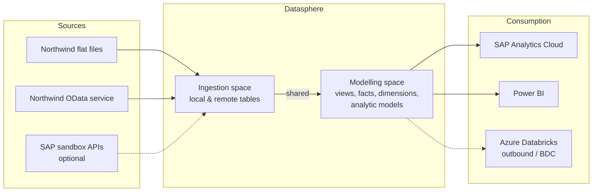

# Architecture

Living view of the solution; updated as each unit adds objects.

## Target (provisional)

## Current state

Unit 01 is documented but not yet executed in the tenant, so nothing is confirmed built.
Planned objects (see `units/01-space-model-remote`): space `NW_LAB`, local tables
`LT_NW_CUSTOMERS`/`LT_NW_ORDERS`/`LT_NW_ORDER_DETAILS`, views `DIM_NW_CUSTOMER` and
`FACT_NW_SALES`, analytic model `AM_NW_SALES`, connection `CN_NW_ODATA`, remote table
`RT_NW_ORDERS`, generated time dimension `SAP.TIME.*`.
