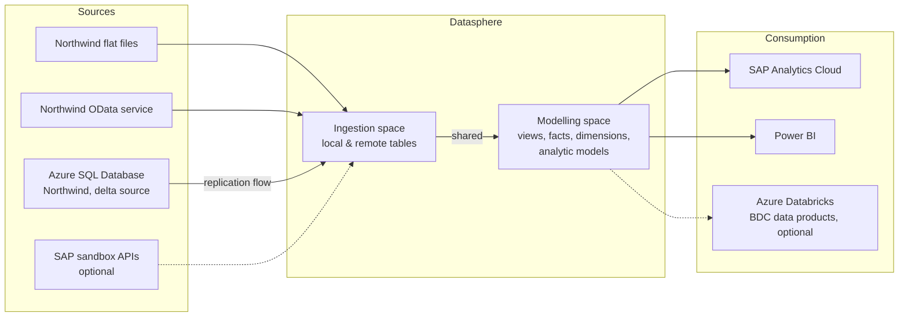
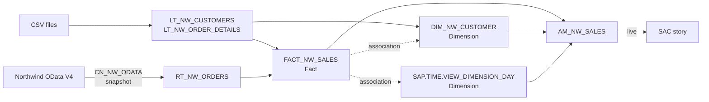

# Architecture

Living view of the solution; updated as each unit adds objects.

## Target

## Current state

After unit 01, everything lives in the own space `NW_LAB` (2 GB disk / 1 GB memory, time
data 1900–2050). A minimal star schema: one fact view with two associations, consumed
live by SAC through an analytic model.

| Layer | Objects |
| ----- | ------- |
| Sources | Northwind CSV files (generated from the OData service); Northwind OData V4 via `CN_NW_ODATA` |
| Ingestion | `LT_NW_CUSTOMERS`, `LT_NW_ORDER_DETAILS` (local, CSV); `RT_NW_ORDERS` (remote table, snapshot replication); `LT_NW_ORDERS` (kept, no longer used) |
| Semantic | `FACT_NW_SALES` (Fact); `DIM_NW_CUSTOMER` (Dimension); `SAP.TIME.*` (generated time data) |
| Consumption | `AM_NW_SALES` (analytic model) → SAC story `Northwind Sales Overview` |

Solid arrows are data flows; dotted arrows are associations, resolved by the analytic
model only when a query asks for the dimension.
