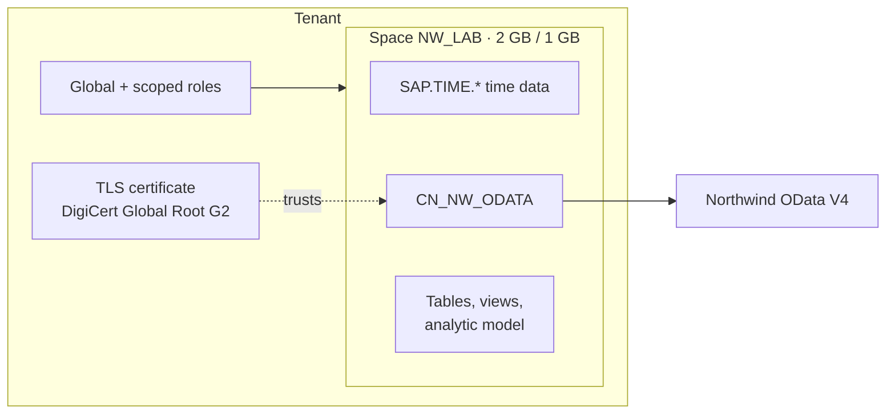

# P0 — Tenant & governance setup

**Status:** done (2026-10-20) · **Units:** [01](../../units/01-space-model-remote/README.md)

## Goal

Give the project a governed place to live in the tenant: an own space with a sized quota,
the right roles, a validated connection to the source, and the shared services the later
phases depend on (time data, trusted certificates).

## What was built

| Area | Result |
| ---- | ------ |
| Space | `NW_LAB` (*Northwind Lab*), SAP HANA disk and in-memory storage, quota 2 GB disk / 1 GB memory, deployed |
| Access | Global *DW Administrator* (create spaces, tenant settings) plus scoped roles that include `NW_LAB` for modelling and space administration; only the project's own user is assigned to the space |
| Time data | Generated in the space for 1900–2050: time table, four dimension views, three translation tables (`SAP.TIME.*`) |
| Connection | `CN_NW_ODATA`, Generic OData V4 to the public Northwind service, no authentication; validated (remote tables and data flows available, replication flows not supported) |
| Trust | *DigiCert Global Root G2* uploaded as a tenant-wide *TLS Server* certificate (in `datasphere/certs/`) |
| Definitions as code | Sanitized CSN/JSON exports in `datasphere/csn/`; they re-import as they are |

Unit 01 also ran a first thin slice through the later phases: CSV ingestion and a remote
table with snapshot replication (P1), a graphical fact view (P2), a customer dimension,
associations and the time dimension in an analytic model (P3), and a live SAC story (P6).
Those phases are marked *started* in the README, not done.

## Key decisions

All in [`docs/decisions.md`](../decisions.md):

- **Start in a shared space, then move to an own space.** The training tenant first
  suggested working in a trainer-provided space using folders. Once admin rights were
  confirmed, everything moved to `NW_LAB` by CSN/JSON export and import, a data reload and
  a rebuilt story. Totals were unchanged.
- **Trust the chain's root, not a similar-looking one.** The tenant already held an older
  DigiCert root; the Northwind chain ends at *Global Root G2*, which had to be added.
- **Naming convention** `<TYPE>_<DOMAIN>_<ENTITY>` ([`docs/naming.md`](../naming.md)).
- **Snapshot replication** of the remote orders table when federation timed out
  (strictly P1, decided during the P0 unit).

## Lessons

- A space ID is permanent from *Create*; quotas are reserved from the tenant pool whether
  used or not.
- A global role isn't enough to work inside a space: a scoped role is (a DW Administrator
  alone can't see the space's time data).
- Adding a space to an existing scoped role's scopes assigns **all** of that role's users
  to it. Review the space's users straight after.
- Connections are per space; certificates are per tenant. Recreating the connection in the
  new space validated on the first try.
- CSN/JSON export carries definitions only: no data, and imported objects aren't
  deployed. Tenant-internal identifiers must be scrubbed before committing an export.

## Deferred

- **Data access controls and cross-space sharing** → P4. They need a second, real space
  (for example a separate ingestion space shared into a modelling space).
- **Workload management** (space priority, statement limits) is tenant-level under
  *System → Configuration*. It was looked at, not changed.
- **Database users** for Power BI → P6.
- **Replication flows** → P1/P7 (provisional plan in the decision log).
