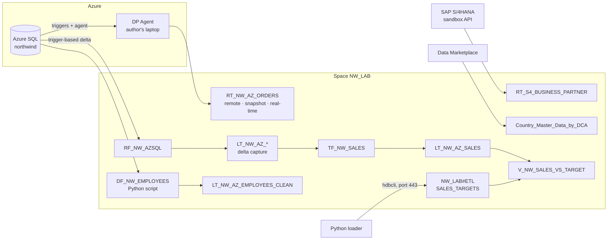

# Phase B — Ingestion & integration

**Status:** ✅ done (2026-10-29) ·
**Narrative and incidents:** [build log](../build-log.md) · **Evidence:** [screenshots](../evidence/phase-b/README.md) ·
**Inventory:** [all phases](README.md)

## Goal

Bring Northwind into `NW_LAB` through every ingestion path Datasphere offers and measure what
each one costs: federation, snapshot and real-time remote tables, schedules, replication flows
with delta, transformation flows, data flows with Python, the Open SQL schema and the Data
Marketplace. The delta-capable source is a free Azure SQL Database loaded with Microsoft's
Northwind script. Every load is reconciled against the Phase A totals: Quantity **51,317**,
revenue **1,265,792.64**.

## What was built

| Area | Result |
| ---- | ------ |
| Sources | Azure SQL Database `northwind` (serverless free offer) with a least-privilege login `dsp_rep` ([`sql/azure-sql/`](../../sql/azure-sql/)); the public Northwind OData service (Phase A); SAP's S/4HANA Cloud sandbox API (Business Partner) |
| Connections | `CN_NW_AZSQL` (replication flows, data flows, and remote tables through a DP Agent); `CN_NW_S4SBX` (Generic OData V2 with an API-key header: remote tables and data flows, no replication flows) |
| DP Agent | SAP HANA smart data integration agent 2.8.1.2 on the author's laptop, MssqlLogReaderAdapter, registered with the tenant; laptop IP in the tenant's IP allowlist |
| Remote tables | `RT_NW_AZ_ORDERS` measured in all three access modes (remote, snapshot with partitions, real-time); `RT_S4_BUSINESS_PARTNER` federated from the SAP sandbox; `RT_NW_ORDERS` (Phase A) on a daily schedule |
| Replication flow | `RF_NW_AZSQL`: 8 Azure tables → local tables `LT_NW_AZ_*` with delta capture; *Initial and Delta*, delta runs on demand (*At Scheduled Time*); inserts, updates and deletes proven |
| Transformation flow | `TF_NW_SALES`: order lines (delta source) left-joined to order headers (active records) → `LT_NW_AZ_SALES` at line grain, with `REVENUE` and `ORDER_DATE`; *Initial and Delta* by watermark |
| Data flow | `DF_NW_EMPLOYEES`: Azure `Employees` read directly → projection → Python script operator (`FULL_NAME`, `PHONE_DIGITS`) → `LT_NW_AZ_EMPLOYEES_CLEAN` (truncate and reload) |
| Open SQL schema | Database user `NW_LAB#ETL` with read and write access; [`scripts/load_sales_targets.py`](../../scripts/load_sales_targets.py) writes 62 synthetic targets (`SALES_TARGETS`) from a laptop over `hdbcli`; the SQL view `V_NW_SALES_VS_TARGET` compares them with the replicated actuals |
| Data Marketplace | *Global Country Identifier Data* (free, integrated delivery) installed: remote table `Country_Master_Data_by_DCA`, 244 countries with ISO codes and coordinates |
| Outbound to ADLS Gen2 | Documented, not built: the tenant can't allocate premium outbound capacity ([decision](../decisions.md)) |

## Measured: which ingestion path when

All numbers come from this build: 830 orders, 2,155 order lines, a free serverless Azure SQL
Database and a DP Agent on a laptop. They show the shape of each path's cost, not production
throughput.

| Path | What it costs | Freshness | Measured here | Use it when |
| ---- | ------------- | --------- | ------------- | ----------- |
| Remote table, remote access | Every query goes to the source; only what the adapter pushes down runs there | Live | Azure: `TOP`, `COUNT` and `WHERE` pushed, ~0.65 s per statement through the agent. OData: `$select`/`$filter`/`$top` pushed, but no count (`1000 / n` in previews) and no aggregation (HANA aggregated every fetched row) | Small, rarely read data, or data that mustn't be copied |
| Remote table, snapshot | One full load per refresh; a replica on disk | As of the last load | 830 rows in 7 s, 208.9 KB on disk; a failed load keeps the old replica; partitioned load = one statement per range plus catch-all ranges; daily schedule ran unattended two days in a row | Read-heavy data that changes slowly; no delta needed |
| Remote table, real-time | Insert/update/delete triggers on every source write, plus a database DDL trigger | Seconds | Changes visible almost at once; with the agent stopped they queued at the source and arrived after the restart | Low-latency needs on sources an agent can reach; worth the extra source write cost |
| Replication flow | A job on the data-integration runtime, billed by duration; trigger-based capture at the source | Per run (or continuous with *On Delta Interval*) | Initial load of 8 tables done in ~3 min; each delta run took 1–2 min for a single changed row (fixed job overhead); deletes kept as `D` in the delta table | Bulk and delta loads from SAP and database sources; SAP's default path |
| Transformation flow | SQL in the space's HANA; reads only delta rows past a watermark | Per run | 2,155 lines in 6 s; a changed line → 1 record processed; a header-only change → 0 records until the watermark is reset | Turning delta-captured tables into modelled tables (bronze → silver) |
| Data flow | A job on the data-integration runtime; full reload each run (no delta) | Per run | 9 rows took 2 min 40 s, then 1 min 45 s; Python per batch | Python logic in a HANA space, sources a replication flow can't read (Generic OData, files), one-off ETL |
| Open SQL schema | An external tool writes; Datasphere neither schedules nor monitors the load | Whatever the tool does | 62 rows from a Python `hdbcli` client on an allowlisted IP; reruns idempotent (delete + insert); the schema appears as its own node in the *Source Browser* and views reference the table by name | Partner tools, scripts and pipelines pushing data in; BI and Databricks reading exposed views out |
| Data Marketplace | Install once (or receive updates for *Full Replication* products) | Provider-defined | 244 countries installed in one step | Reference data you'd otherwise curate yourself |

## Key decisions

All in [`docs/decisions.md`](../decisions.md):

- **Azure SQL Database as the delta source.** Free, scriptable from Microsoft's own Northwind
  script, and supported by replication flows with trigger-based change capture.
- **A DP Agent for real-time remote tables**, time-boxed, so the one access mode that needs an
  agent could be built hands-on.
- **Delta runs on demand (*At Scheduled Time*)** rather than a permanently running flow: the
  flow is billed by job duration, and orchestration belongs to task chains (Phase E).
- **Transformation flows added to the plan** (the T in ELT inside Datasphere); the line-grain
  design and its left join follow from SAP's delta rules.
- **Round the source's `real` discount before computing revenue** (`TO_DECIMAL` truncates).
- **Outbound to ADLS Gen2 documented, not built**: no premium outbound capacity on this tenant.
  Databricks reads through the Open SQL schema instead, with BDC in Phase H.

## Lessons

- **Network direction matters.** Replication and data flows leave SAP through egress NAT IPs
  that go into the source's firewall; agents and SQL clients come in and go into the tenant's
  IP allowlist.
- **A connection's features follow its type, not its data.** S/4HANA data over a Generic OData
  connection gets no replication flows.
- **Federation cost is pushdown.** The same view is cheap on one adapter and expensive on
  another; *Remote Queries* shows exactly what was sent.
- **Delta tables hold the latest state per key**, with deletes kept as `D` rows. Views read the
  active records; transformation flows read the deltas.
- **A transformation flow has one delta source.** Changes that only touch a joined table are
  invisible until the watermark is reset, and nothing reports it.
- **Types drift at the boundary.** A `real` column made HANA compute revenue in single
  precision, and HANA's `TO_DECIMAL` truncates where SQL Server's `CAST` rounds. Only an
  engine-independent recalculation from the CSV explained both totals to the cent.
- **Idempotent isn't atomic.** The loader's delete + insert gave the same result on every
  rerun, but `hdbcli` autocommits by default, so a failure between the two statements would
  have left the table empty. One explicit transaction fixes it.
- **A full outer join is a reconciliation tool.** Actuals and targets came from two
  independent builds; no nulls on either side and matching totals prove the keys line up.
- **Job runtimes carry fixed start-up costs.** One-row replication and data flow runs still
  took one to three minutes, so frequency, not volume, drives their cost.

## Open and deferred

- **Lab changes kept on purpose** ([decision](../decisions.md)): the laptop IP stays in the
  tenant's allowlist until Phase F; the DP Agent stays registered with its service stopped.
- **Country names** in Northwind (`USA`, `UK`) don't match the Marketplace's ISO names →
  Intelligent Lookup in Phase C, behind a `DIM_NW_COUNTRY` wrapper view.
- **Task chain over replication flow → transformation flow → data flow** → Phase E.
