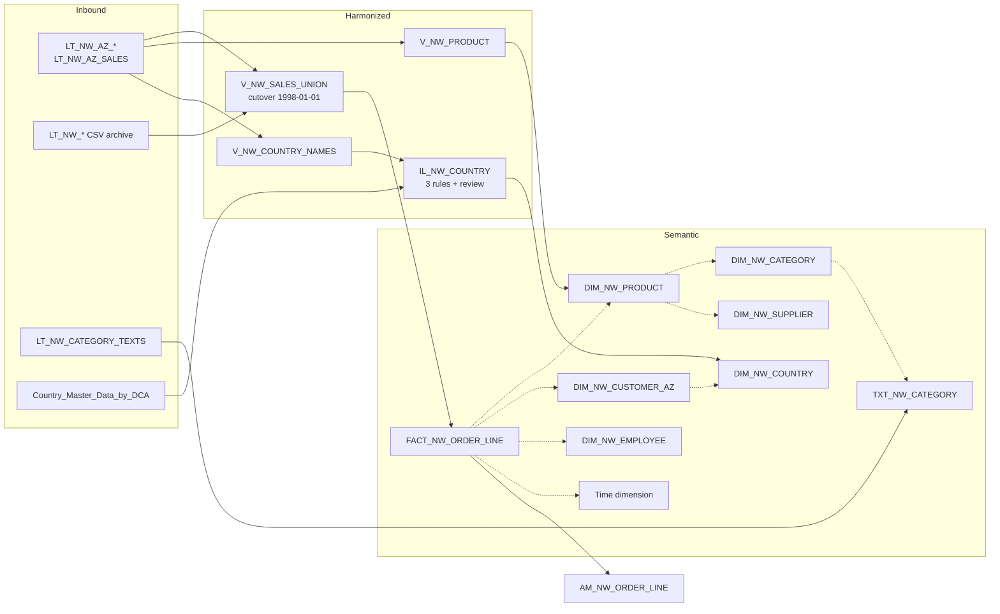

# Phase C — Modelling in the Data Builder

**Status:** ✅ done (2026-11-05) ·
**Narrative and incidents:** [build log](../build-log.md) · **Evidence:** [screenshots](../evidence/phase-c/README.md) ·
**Inventory:** [all phases](README.md)

## Goal

Turn Phase B's landed tables into a proper semantic model: harmonized views, joins and a union,
dimensions with text and every hierarchy type, a fact with associations, an analytic model to
test it on, view persistence measured before and after, and an Intelligent Lookup that matches
Northwind's country names to an external reference set. Everything that carries sales reconciles
to **2,155 lines, Quantity 51,317, revenue 1,265,792.64**.

## What was built

| Area | Result |
| ---- | ------ |
| Harmonized views | `V_NW_PRODUCT` (standard SQL, 77 rows); `V_NW_PRODUCT_RANK` (SQLScript table function with a window rank, 77 rows, total 1,265,792.64) |
| Joins | `V_NW_CUSTOMER_ORDERS`: left join, *Exactly One → Many*, 91 customers including `FISSA` and `PARIS` with 0 orders |
| Union | `V_NW_SALES_UNION`: a cutover at 1998-01-01 with a `SOURCE_SYSTEM` column. CSV tables are the legacy archive, Azure tables the live system |
| Text | `LT_NW_CATEGORY_TEXTS` → `TXT_NW_CATEGORY`: 8 categories in EN/ES/DE, 24 rows (synthetic) |
| Dimensions | `DIM_NW_PRODUCT` (77, → category, → supplier), `DIM_NW_CATEGORY` (8), `DIM_NW_SUPPLIER` (29), `DIM_NW_EMPLOYEE` (9), `DIM_NW_CUSTOMER_AZ` (91), `DIM_NW_COUNTRY` (21) |
| Fact | `FACT_NW_ORDER_LINE` on the union: measures `Quantity` and `REVENUE`, associations to product, customer, employee and the generated time dimension |
| Hierarchies | One type per dimension, all three in one model: level-based `H_CATEGORY_PRODUCT`; parent-child `H_REPORTS_TO` plus external `HIER_NW_EMPLOYEE`; hierarchy with directory `HIER_NW_CUSTOMER_DIR` with two trees, by location and by contact title |
| Analytic model | `AM_NW_ORDER_LINE`: fact plus four dimensions, used here to drill every hierarchy. Measures and variables follow in Phase D |
| Persistence | `V_S4_BP_BY_CATEGORY` persisted and kept; `V_NW_SALES_UNION` persisted with partitions, measured, and returned to virtual |
| Intelligent Lookup | `IL_NW_COUNTRY`: 21 country names matched to `Country_Master_Data_by_DCA` with three rules and a review, wrapped in `DIM_NW_COUNTRY` |

Solid arrows are data; dotted arrows are associations, resolved only when a query asks for the
dimension.

## Measured

### Union, per leg

| Leg | Orders | Lines | Quantity | Revenue |
| --- | ------ | ----- | -------- | ------- |
| `CSV_ARCHIVE` (up to 1997-12-31) | 560 | 1,464 | 35,070 | 825,168.92 |
| `AZURE_LIVE` (from 1998-01-01) | 270 | 691 | 16,247 | 440,623.72 |
| Total | 830 | 2,155 | 51,317 | 1,265,792.64 |

Both legs match a calculation from the raw CSV files.

### View persistence (one run each, *Runtime Metrics*)

| View | Rows | Sources | Select 1,000, before → after | Count, before → after |
| ---- | ---- | ------- | ---------------------------- | --------------------- |
| `V_S4_BP_BY_CATEGORY` | 2 | Federated OData | 0.49 → 0.01 s | 1.47 → 0.01 s |
| `V_NW_SALES_UNION` | 2,155 | Local tables | 0.07 → 0.03 s | 0.04 → 0.01 s |

The gain follows the cost of reaching the source, not the row count. View Analyzer gave the local
union a candidate score of **10, *Best Option***, because it was the only view in its lineage: the
score ranks candidates within a lineage and doesn't say persisting is worth it. The union's
partitions loaded 1,464 (archive, locked on the second run), 691 (live) and 0 (*OTHERS*). The
evidence shot shows 290 KB in memory and 197 KB on disk; an earlier reading showed 670 and 205, with
the unit not noted and the difference not explained. Saving at most 0.04 s didn't justify serving the
fact a frozen snapshot, so it went back to virtual on 2026-11-05: 0 B, model totals unchanged, and the
partition definition still in place.

### Intelligent Lookup (21 countries)

| Step | Countries | Running total | Which |
| ---- | --------- | ------------- | ----- |
| Exact on name | 18 | 85.7 % | Everything spelled the same |
| Fuzzy on name, confirmed in review | 1 | 90.5 % | `Venezuela` → *Venezuela, Bolivarian Republic of* |
| Exact on the ISO-3 code | 1 | 95.2 % | `USA`, which is an ISO-3 code but not a country name |
| Matched by hand | 1 | 100 % | `UK`: the fuzzy rule proposed **Ukraine**, and the ISO code is GB |

All 21 ISO-2 codes were then checked against the public ISO 3166-1 list, and `UNMATCHED_RECORD` shows
`false` on every row. The lookup's own diagram reads 86 % / 5 % / 10 %: its last figure counts `USA` and
the manual `UK` together, and rounding takes the sum to 101.

## Key decisions

All in [`docs/decisions.md`](../decisions.md):

- **Model on the replicated Azure tables**, with Phase A's objects left alone as v1 until Phase D.
- **A cutover union**, since both sources hold the same data and a plain union would double it.
- **Layers:** inbound, harmonized, semantic, analytic model; each has one job.
- **No shipper dimension:** the CSV archive leg has no `ShipVia`, so it'd be null for two thirds of
  the lines.
- **One hierarchy type per dimension.** A rule in the product, turned into a design: each dimension
  shows a different type, and all three work in one model.
- **Persist on evidence:** the federated view stays persisted, the local union doesn't.
- **A dedicated exact rule on ISO-3**, not extra columns in the fuzzy rule.

## Lessons

- **Check per leg.** A union that reconciles only in total can hide two errors
  that cancel out. Each leg had its own independent target.
- **A union takes its types from the first leg.** The CSV leg's types won until they were cast to
  match Azure's. One gap is kept on purpose: the fact's `CustomerID` is String(5000) against
  String(5) in the dimension, and the association still matches on value.
- **Associations add no rows.** A left join can multiply a fact; an association is only resolved
  when a query asks for that dimension.
- **Hierarchy rules surface as UI states.** The one-type-per-dimension rule shows up as a greyed-out
  menu option, with no message saying why.
- **Parents carry their own postings.** In a parent-child tree, a node shows its subtree total with
  no row for its own revenue, so visible children can sum to less than the parent.
- **A score isn't a verdict.** `UK` → Ukraine and `Venezuela` → its official name both reached the
  same *Review* tab, one wrong. Unreviewed proposals are in the output by default, while unmatched
  records silently drop.
- **Match on what the value is.** `USA` failed on names because it's a code, so a code rule catches
  it exactly.
- **The docs and the tenant disagree in places**, so check what's generated. *Preview SQL* showed a
  graphical `COUNT` as plain `COUNT(col)` where the docs say distinct. Deleting a column used by a
  SQLScript consumer gave no warning, where the docs describe one.

## Open and deferred

- **`AM_NW_ORDER_LINE` measures and variables** → Phase D. So is exposing `DIM_NW_COUNTRY` in the
  model.
- **Phase A's `FACT_NW_SALES`, `DIM_NW_CUSTOMER`, `AM_NW_SALES` and SAC story** stay as v1 until
  Phase D or F decides whether they retire.
- **Scheduling persistence and the Intelligent Lookup run** → task chains in Phase E.
