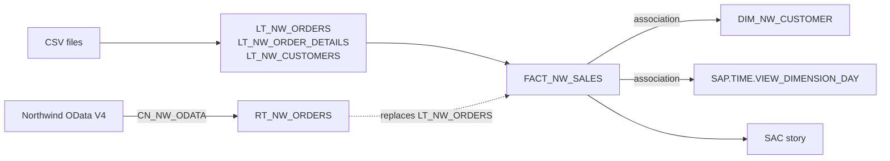

# Unit 01 — Space, first model and report, remote source

**Phase:** P0 — Tenant & governance setup (also a first thin slice through P1 ingestion, P2
transformation, P3 semantic layer and P6 consumption) · **Builds on:** — · **Status:**
in progress

> **⚠ verify** marks steps written from general product knowledge that may differ in your
> tenant's version or licence. Report any deviation and I'll correct the text.

## Course objective

Go once through the whole chain on a small scale: create a space, load files, build a first
view, report on it in SAC, then swap a local table for a remote one and add a time
dimension and associations. See [`syllabus.md`](../../syllabus.md) for the objectives in my
words.

## Concepts

| Concept | What to understand | Why it matters here |
| ------- | ------------------ | ------------------- |
| **Space** | The unit of isolation in Datasphere: own objects, own storage quota, own members and roles. Objects are invisible to other spaces unless shared. | Everything in this project lives in a space; governance (P0, P4) starts here. |
| **Local table** | Table whose data is stored in Datasphere (here filled by a CSV upload). | Replicated/persisted data: fast, independent of the source. |
| **Remote table** | A table definition pointing at a source object through a connection. Data access is *remote* (federated, read on demand) or *replicated* (copied into Datasphere). | The core federation-vs-replication trade-off of this project. Here we only use federation. |
| **Connection** | Reusable, per-space definition of how to reach a source system (type, URL, authentication). | One connection serves many remote tables, flows and previews. |
| **Graphical view & view editor** | Drag-and-drop model: sources → join → projection → calculated columns → output node with semantic usage and exposure settings. | The main modelling tool for P2/P3. |
| **Semantic usage** | Declares the role of a view: *Relational Dataset*, *Dimension*, *Fact*, *Text*, *Hierarchy*. Measures vs attributes is set on the output. | Drives what consumers (SAC, Power BI) can do with it. |
| **Association** | A relationship from a view to a dimension (or text/hierarchy) by key. Lazy: resolved at query time, not a join in the data flow. | Keeps the fact narrow and reuses dimensions; the basis of the star schema. |
| **Time dimension** | Generated, calendar-based table and dimension views per space (day/month/quarter/year). | Consistent time analysis without hand-built date tables. |
| **Expose for consumption** | Switch that makes a view visible to consumers such as SAC and Power BI. | Without it, nothing downstream sees the view. |

### Federation vs. replication, in one paragraph

A remote table in *remote* mode sends every query to the source: always fresh, no storage
used, but speed and availability depend on the source and the network, and not every
operation can be pushed down. *Replicated* mode copies the data and serves queries locally.
This unit swaps a local table for a remote one in an existing model to show that the model
doesn't care which one is underneath. The decision of which mode to use per table is
revisited in P1.

## Exercise

Build **Northwind Sales** as a first star-schema slice:

- Source **flat files** (`customers`, `orders`, `order_details`) into local tables.
- A graphical **fact view** of order lines with `REVENUE = UnitPrice × Quantity × (1 − Discount)`.
- A **customer dimension** and the generated **time dimension**, linked by associations.
- A **SAC story**: revenue over time (year → quarter → month) and revenue by customer
  country.
- Finally, **replace `LT_NW_ORDERS` by a remote table** read live from the public Northwind
  OData service, with the story unchanged.

Objects created (see [`docs/naming.md`](../../docs/naming.md)):

| Technical name | Type | Business name |
| -------------- | ---- | ------------- |
| `NW_LAB` | Space | Northwind Lab |
| `LT_NW_CUSTOMERS` | Local table | Northwind Customers (file) |
| `LT_NW_ORDERS` | Local table | Northwind Orders (file) |
| `LT_NW_ORDER_DETAILS` | Local table | Northwind Order Details (file) |
| `DIM_NW_CUSTOMER` | Dimension view | Customer |
| `FACT_NW_SALES` | Fact view | Sales |
| `CN_NW_ODATA` | Connection | Northwind OData V4 |
| `RT_NW_ORDERS` | Remote table | Northwind Orders (remote) |
| `SAP.TIME.*` | Time dimension (generated) | — |



### Prerequisites

- Access to the tenant. Your role decides how far you get: creating a space needs a space
  administrator-type role (⚠ verify the exact role name: usually *DW Administrator* or
  *DW Space Administrator*). **If you can't create a space**, do the unit in the trainer's
  `Lab` space instead, skip steps 3–6, and report back so the decision is logged.
- The three CSV files. Generate them locally from the public service (no manual download):

  ```powershell
  python scripts\export_northwind.py
  ```

  This writes `customers.csv` (91 rows), `orders.csv` (830) and `order_details.csv` (2,155)
  into `data\raw\`. Dates are exported as `YYYY-MM-DD`.
- A SAC tenant and a way to reach Datasphere from it (⚠ verify: either a live connection
  set up by an admin or the trainer, or the integrated SAC of your tenant).

### Steps

#### A. Space

1. **Check your access.** Open *Space Management* (⚠ verify: left menu) and note whether
   *Create* is available, and which roles you hold (*System → Administration → Users* or
   your profile). Record the answer in **Results**.
2. **Inspect the existing space.** Open the trainer's `Lab` space: note its members, assigned
   storage and which objects it contains. This is what you will replicate on purpose in
   your own space.
3. **Create the space.** *Space Management → Create*: space name `Northwind Lab`, space ID
   `NW_LAB` (add a short suffix if the ID is taken; see `docs/naming.md`). Leave *Space
   Type* as default (⚠ verify: SAP HANA Database / file spaces).
4. **Assign storage.** Set disk storage to a small value (e.g. 1 GiB) and in-memory to
   0 or the minimum allowed. ⚠ verify: the quota available depends on the tenant size.
   *Why:* quotas are shared by all spaces; over-allocating in a training tenant blocks
   others.
5. **Add yourself as member** and confirm your scoped role grants *create* on Data Builder
   objects (⚠ verify: scoped role such as *Space Administrator* or *Modeler*). Save and
   *Deploy*.
6. **Review the space settings** you will use later and just note them: *Time Data*,
   *Connections*, *Members*, *Data Access Controls*, *Auditing*. No changes yet.

#### B. First model: local tables → graphical view

7. **Upload `customers.csv`.** *Data Builder → New Table → Upload CSV* (⚠ verify: it may sit
   under *Import → Import CSV File*). Pick `customers.csv`, delimiter `,`, header row on,
   encoding UTF-8. In the preview set `CustomerID` as key. Set technical name
   `LT_NW_CUSTOMERS`. Deploy.
8. **Upload `orders.csv`** the same way as `LT_NW_ORDERS`: key `OrderID`; ensure `OrderDate`,
   `RequiredDate`, `ShippedDate` are typed **Date** and `Freight` as Decimal. Deploy.
9. **Upload `order_details.csv`** as `LT_NW_ORDER_DETAILS`: composite key `OrderID` +
   `ProductID`; `UnitPrice` Decimal, `Quantity` Integer, `Discount` Decimal. Deploy.
10. **Preview the data** of each table (*Data Preview*) and compare row counts with 91, 830
    and 2,155.
11. **Create the dimension view.** *New Graphical View* → add `LT_NW_CUSTOMERS` → set the
    output node: semantic usage **Dimension**, `CustomerID` as key, others as attributes
    with business names. Technical name `DIM_NW_CUSTOMER`. Deploy.
12. **Create the fact view.** *New Graphical View*, then in the view editor:
    1. Drag `LT_NW_ORDER_DETAILS` onto the canvas (source node).
    2. Drag `LT_NW_ORDERS` onto the first node's **Join** target; set the join on `OrderID`,
       inner join, cardinality many-to-one (⚠ verify: join node options).
    3. Select the join node's output and add a **Calculated Column** `REVENUE` =
       `"UnitPrice" * "Quantity" * (1 - "Discount")`, type Decimal.
    4. Add a second calculated column `ORDER_DATE` = `TO_DATE("OrderDate")`, type Date.
       *Why:* the same expression works whether the source delivers a date or a
       timestamp, so the later source swap needs no change (see step 29).
    5. Remove columns you don't need from the output (keep `OrderID`, `ProductID`,
       `CustomerID`, `ShipCountry`, `ORDER_DATE`, `Quantity`, `UnitPrice`, `Discount`,
       `REVENUE`).
    6. In the output node: semantic usage **Fact**, mark `Quantity` and `REVENUE` as
       **Measures**, others as Attributes. ⚠ verify: in current versions "Analytical
       Dataset" was folded into *Fact* + *Analytic Model*.
    7. Name `FACT_NW_SALES`, save, deploy.
13. **Use the view editor tools** and note what each does: *Data Preview* on a node, *View
    Properties* (semantic usage, expose for consumption), *Data Viewer*, *Impact and
    Lineage* (⚠ verify location of the lineage/analysis view). Add one **filter** on the
    join result (e.g. drop orders without a `CustomerID`), preview the row count, then remove it
    again so the totals stay comparable later (steps 21–22 vs. 30).

#### C. Time dimension and associations

14. **Generate the time dimension.** *Space settings → Time Data → Create Time Tables and
    Dimensions* (⚠ verify: may be named *Time Data* in the space's *Settings* tab). Range
    **1996 to 1999** (Northwind orders cover 1996-07 to 1998-05), calendar and fiscal year
    options default. Create.
15. **Locate the generated objects** in the Data Builder (`SAP.TIME.*`, e.g. the day-level
    dimension view). Preview the day-level dimension and identify its key column (⚠
    verify: typically `DATE_SQL`).
16. **Add the customer association.** Open `FACT_NW_SALES` → output node → *Associations* →
    add `DIM_NW_CUSTOMER`, map `CustomerID` → `CustomerID`.
17. **Add the time association.** Add the day-level time dimension, map `ORDER_DATE` → its
    date key. Redeploy.
18. **Inspect what the associations give you.** In the output node, expand the associations
    and check the attributes of `DIM_NW_CUSTOMER` (Company, City, Country) and the time
    attributes (Year, Quarter, Month) are available without having been joined. Note the
    difference between *join* (step 12) and *association* (steps 16–17) in **Results**.
19. **Make it consumable.** In *View Properties* of `FACT_NW_SALES` turn on **Expose for
    Consumption**; deploy. ⚠ verify: if SAC in your tenant only lists *analytic models*,
    create a minimal `AM_NW_SALES` on top of the fact view (measures `REVENUE`, `Quantity`,
    attributes from both associations) and log it as a deviation; the full treatment is P3.

#### D. First story in SAC

20. **Create a story.** In SAC: *Stories → Create → Story → Add data → Live data from
    Datasphere* (⚠ verify: wording; requires a live connection to your tenant). Choose the
    space `NW_LAB` and `FACT_NW_SALES` (or `AM_NW_SALES`).
21. **Chart 1 — revenue over time.** Add a *Time Series* or *Bar/Column* chart: measure
    `REVENUE`, dimension the time **Year**, then drill to *Quarter* and *Month* (⚠ verify:
    drilling needs the time hierarchy to be exposed).
22. **Chart 2 — revenue by customer country.** Bar chart: `REVENUE` by *Country* from
    `DIM_NW_CUSTOMER`. Sort descending, show top 10.
23. **Add a KPI/number tile** for total `REVENUE` and one for `Quantity`.
24. **Save the story** as `Northwind Sales Overview`. Capture a screenshot (scrub tenant URL
    and user name) to `assets\`.

#### E. Remote connection and remote table

25. **Create the connection.** In `NW_LAB` → *Connections → Create → OData* (⚠ verify:
    generic OData connection type). URL
    `https://services.odata.org/V4/Northwind/Northwind.svc/`, OData version **V4**,
    authentication *None*, no cloud connector. Name `CN_NW_ODATA`. *Validate* — it must
    succeed. ⚠ verify: tenants can block outbound access to public hosts; if validation
    fails, try the V2 URL `https://services.odata.org/V2/Northwind/Northwind.svc/` and
    record the result either way.
26. **Check what the connection supports** (feature icons on the connection: remote tables,
    data flows, replication flows) and note them.
27. **Import the remote table.** *Data Builder → Import → Remote Tables* → connection
    `CN_NW_ODATA` → entity `Orders` → import and deploy as `RT_NW_ORDERS`. Leave data
    access on **Remote** (federated). Preview the data: 830 rows.
28. **Compare local vs. remote.** Preview `LT_NW_ORDERS` and `RT_NW_ORDERS`; note column
    names and data types that differ (OData delivers `OrderDate` as a date-time, the
    local table as a date).
29. **Replace the source.** In `FACT_NW_SALES`, select the `LT_NW_ORDERS` source node and
    use *Replace Source* (⚠ verify: context menu or properties panel), choose
    `RT_NW_ORDERS`; map columns. If any column fails to map, fix by name. Save, deploy.
    The `TO_DATE` calculated column should keep working unchanged.
30. **Re-test the story.** Refresh the SAC story; numbers must match those from step 21–22
    (same data, different path). Note any difference in response time.
31. **Check the data access mode.** In the remote table's properties see the
    *Data Access* options (Remote / Replicated) and what a replication would require
    (⚠ verify). Don't enable it; this is for P1.

### Acceptance criteria

- [ ] Space `NW_LAB` exists, deployed, with storage assigned and me as member (or the
      deviation "used the trainer's `Lab` space" is documented with the reason).
- [ ] `LT_NW_CUSTOMERS` (91), `LT_NW_ORDERS` (830) and `LT_NW_ORDER_DETAILS` (2,155) are
      deployed with the right key columns and date/decimal types.
- [ ] `DIM_NW_CUSTOMER` (Dimension) and `FACT_NW_SALES` (Fact, measures `REVENUE` and
      `Quantity`) are deployed and previewable.
- [ ] `FACT_NW_SALES` has associations to `DIM_NW_CUSTOMER` and to the day-level time
      dimension, and attributes of both are usable in the story.
- [ ] SAC story `Northwind Sales Overview` shows revenue by year/quarter/month and by
      customer country from live Datasphere data.
- [ ] Connection `CN_NW_ODATA` validates successfully (or the failure and its cause are
      documented, with the fallback used).
- [ ] `RT_NW_ORDERS` returns 830 rows in remote mode and is the source of `FACT_NW_SALES`.
- [ ] Story totals are identical before and after the source swap.
- [ ] I can state the difference between join and association, and between a local and a
      remote table, in my own words (in **Results**).

## Results

_To be filled in from what I report back from the tenant._

## Gotchas

_To be filled in from what I report back from the tenant._

## Link to next unit

Leaves in place: a working space, one connection, a minimal star schema, a time dimension
and a first story. Later units deepen each slice: P1 ingestion modes (replication vs.
federation, data flows), P2 transformation and quality, P3 proper dimensions, hierarchies
and the analytic model.
