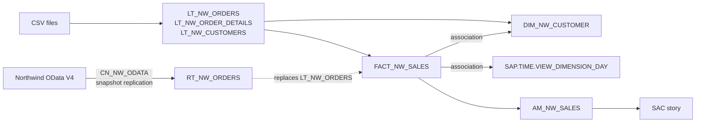

# Unit 01 — Space, first model and report, remote source

**Phase:** P0 — Tenant & governance setup (also a first thin slice through P1 ingestion, P2
transformation, P3 semantic layer and P6 consumption) · **Builds on:** — · **Status:**
done (2026-10-20)

> The steps were checked against the SAP Datasphere documentation and then corrected
> wherever the tenant (Q3 2026 release) behaved differently. Those deviations are listed
> under *Gotchas*.

## Course objective

Go once through the whole chain on a small scale: create a space, load files, build a first
view, report on it in SAC, then swap a local table for a remote one and add a time
dimension and associations. See [`syllabus.md`](../../syllabus.md) for the objectives in my
words. The parts below follow the course order.

## Concepts

| Concept | What to understand | Why it matters here |
| ------- | ------------------ | ------------------- |
| **Space** | The unit of isolation in Datasphere: own objects, own storage quota, own members and connections. Objects are invisible to other spaces unless shared. | Everything in this project lives in a space; governance (P0, P4) starts here. |
| **Global vs. scoped roles** | Global roles (e.g. *DW Administrator*) grant tenant-wide privileges such as creating spaces; scoped roles grant privileges only inside the spaces they are scoped to. | Decides whether you can create your own space or must work in one prepared for you. |
| **Local table** | Table whose data is stored in Datasphere (here filled by a CSV import). | Persisted data: fast, independent of the source, but a copy that ages. |
| **Remote table** | A table definition pointing at a source object through a connection. Data access is *remote* (federated, read on demand) or *replicated* (copied into Datasphere). | The core federation-vs-replication trade-off of this project. Here federation came first; the public source then forced a snapshot replication. |
| **Connection** | Per-space definition of how to reach a source system (type, URL, authentication). | One connection serves many remote tables and flows. |
| **Graphical view & view editor** | Canvas of nodes: sources → operators (join, union, projection, calculated columns, filter, aggregation) → output node, whose properties hold the semantic usage, measures/attributes, associations and *expose for consumption*. | The main modelling tool for P2/P3. |
| **Semantic usage** | Declares the role of a view: *Relational Dataset*, *Fact*, *Dimension*, *Text*, *Hierarchy*. A *Fact* needs at least one measure; a *Dimension* needs a key. | Decides what the view can be used for: only a Fact can feed an analytic model, only a Dimension (or Text/Hierarchy) can be an association target. |
| **Analytic model** | The consumption-ready semantic layer on top of one Fact: chosen measures, dimensions pulled in through the Fact's associations, variables. | **SAC stories consume analytic models**, not raw views. |
| **Association** | A key-based relationship from a view to a Dimension/Text/Hierarchy. Not a join: nothing is joined in the view; the analytic model joins on demand, only for queries that request the dimension's attributes. Every key column of the target must be mapped. | Keeps the fact narrow and reuses dimensions; the basis of the star schema. Close to a Power BI model relationship. |
| **Time dimension** | Generated per space: a time table, four dimension views (day, month, quarter, year) and three translation tables (`SAP.TIME.*`). The day view carries the hierarchies Year–Quarter–Month–Day, Year–Month–Day and Year–Week–Day. | Consistent time analysis without hand-built date tables. SAC supports **only these generated dimensions** as time dimensions. |
| **Expose for consumption** | Switch on a view that makes it consumable by external tools (Power BI, ODBC/OData clients). | Not needed for SAC via an analytic model, but needed for Power BI later (P6). |

### Federation vs. replication, in one paragraph

A remote table in *remote* mode sends every query to the source: always fresh, no storage
used, but speed and availability depend on the source and the network, and not every
operation can be pushed down. *Replicated* mode copies the data and serves queries locally.
This unit swaps a local table for a remote one in an existing model to show that the model
doesn't care which one is underneath. In practice, pure federation against the public
Northwind service hit query timeouts, so the remote table was switched to a snapshot
replication: the same trade-off, decided by evidence. Which mode to use per table is
revisited in P1.

## Exercise

Build **Northwind Sales** as a first star-schema slice, in the course order:

- **A. Space** — your own space `NW_LAB`.
- **B. First model** — three CSV files into local tables; a graphical **fact view** of
  order lines with `REVENUE = UnitPrice × Quantity × (1 − Discount)`.
- **C. First report** — a minimal analytic model and a SAC story of revenue by ship
  country.
- **D. Remote source** — an OData connection to the public Northwind service; replace
  `LT_NW_ORDERS` by the remote table `RT_NW_ORDERS`; story totals unchanged.
- **E. Time dimension and associations** — use the generated time dimension, add a
  customer dimension, associate both to the fact and use them in the story.

Objects created (see [`docs/naming.md`](../../docs/naming.md)):

| Technical name | Type | Business name | Part |
| -------------- | ---- | ------------- | ---- |
| `NW_LAB` | Space | Northwind Lab | A |
| `LT_NW_CUSTOMERS` | Local table | Northwind Customers (file) | B |
| `LT_NW_ORDERS` | Local table | Northwind Orders (file) | B |
| `LT_NW_ORDER_DETAILS` | Local table | Northwind Order Details (file) | B |
| `FACT_NW_SALES` | Fact view | Sales | B |
| `AM_NW_SALES` | Analytic model | Sales Analysis | C |
| `CN_NW_ODATA` | Connection | Northwind OData V4 | D |
| `RT_NW_ORDERS` | Remote table | Northwind Orders (remote) | D |
| `SAP.TIME.*` | Time dimension (generated) | — | E |
| `DIM_NW_CUSTOMER` | Dimension view | Customer | E |



### Prerequisites

- Access to the tenant. Creating a space needs the tenant-wide *create space* privilege,
  which comes with the global role **DW Administrator**. Working *inside* a space also
  needs a scoped role for it (for example a space-administrator scoped role): a
  DW Administrator alone can't see the space's time data. If you can't create a space,
  ask an administrator to create `NW_LAB` and add you.
- The three CSV files. Generate them locally from the public service (no manual download):

  ```powershell
  python scripts\export_northwind.py
  ```

  This writes `customers.csv` (91 rows), `orders.csv` (830) and `order_details.csv` (2,155)
  into `data\raw\`. Dates are exported as `YYYY-MM-DD`.
- SAC with a live connection to this Datasphere tenant, created by a SAC admin, and the
  *DW Consumer* role in Datasphere for story consumption.

### Steps

Condensed, reproducible steps. The build itself was run from a click-level private guide
with comprehension checks after each part.

#### A. Space

> **As executed:** the unit started in a trainer-provided shared space, using a folder as
> a pseudo-space. Once admin rights were confirmed, everything moved to the own space
> `NW_LAB` by CSN/JSON export and import (see *Results*, Part M, and
> `docs/decisions.md`).

1. **Check your access.** Open *Space Management* and see whether *Create* is offered. Check
   your roles (*Security → Users*, or ask an administrator). Note both in
   **Results**: they decide the rest of part A.
2. **Inspect the trainer's `Lab` space.** Look at its members (and their scoped roles),
   storage assignment and connections. This is the reference for your own space.
3. **Create the space.** *Space Management → Create*: space name `Northwind Lab`, space ID
   `NW_LAB` (max 20 characters, upper case). The ID is fixed from the moment you click
   *Create*. Storage type *SAP HANA Database (Disk and In-Memory)*.
4. **Assign storage.** Keep the space quota small: 2 GB disk and 1 GB in-memory. *Why:*
   quotas are reserved from one tenant-wide pool, used or not; over-allocating in a shared
   training tenant blocks other trainees.
5. **Add members and deploy.** Add `NW_LAB` to the scopes of the scoped roles you need
   (*Security → Roles*) and assign yourself. Adding a space to a role's scopes assigns
   **every user of that role** to it; review the space's *Users* afterwards. *Deploy* the
   space, then generate its time data (*Time Data → Create Time Tables and Dimensions*,
   default range 1900–2050).
6. **Tour the space settings** you'll use later, without changing them: *Users*, *Time
   Data*, *Auditing*, *Database Access* (database users, used for Power BI in P6), and
   *Apps → Connections*. Workload settings are tenant-level (*System → Configuration*).

#### B. First model: CSV → local tables → graphical view

7. **Import `customers.csv`.** *Data Builder* → *Import → Import CSV File* → *Select
   Source File* → *Use first row as column header*, delimiter auto-detect → *Upload*. In
   the side panel open each column's *Details*: the importer offers only *Boolean,
   Integer, Number (Decimal(38,19)), String (String(5000)), Date, Time, Date and Time*.
   Set **`PostalCode` to String** (values like `05021` would lose the leading zero) and
   **Set as Key** on `CustomerID`. *Deploy* as `LT_NW_CUSTOMERS`.
8. **Import `orders.csv`** as `LT_NW_ORDERS`: key `OrderID`; `OrderDate`, `RequiredDate`,
   `ShippedDate` as **Date** (21 orders have no `ShippedDate`: nulls are expected);
   `Freight` as **Number**, never *REAL* (binary floating point: `1.1` becomes
   `1.100000023841858`).
9. **Import `order_details.csv`** as `LT_NW_ORDER_DETAILS`: keys `OrderID` + `ProductID`;
   `UnitPrice` and `Discount` **Number**, `Quantity` Integer.
10. **Check the tables.** Open each in the table editor (keys, types) and *Preview Data*.
    Row counts in *Monitoring → Data Integration → Local Tables*: 91, 830 and 2,155.
11. **Build the fact view.** *Data Builder → New Graphical View*:
    1. Drag `LT_NW_ORDER_DETAILS` from the *Source Browser* onto the canvas; an output node
       is created automatically.
    2. Drop `LT_NW_ORDERS` onto that node (it turns green) to create a **Join**: *Inner*,
       cardinality `MANY TO ONE`, mapped on `OrderID`. Datasphere adds a **Projection**
       after the join to remove duplicate columns; exclude the columns not needed there.
    3. Add a **Calculated Columns** node: `REVENUE` = `"UnitPrice" * "Quantity" *
       (1 - "Discount")` (Decimal 15,2) and `ORDER_DATE` = `TO_DATE("OrderDate")` (Date).
       *Why `ORDER_DATE`:* `TO_DATE` works on both a date and a timestamp, so the source
       swap in part D (OData returns a timestamp) needs no change in the view.
    4. Output node: technical name `FACT_NW_SALES` (fixed once saved), semantic usage
       **Fact**; *Change to Measure* on `REVENUE` and `Quantity` (aggregation SUM).
       *Expose for Consumption* stays off: an analytic model doesn't need it.
    5. Save and deploy. Each source or join takes at most one *Filter*, *Projection*,
       *Calculated Columns* and *Aggregation* node.
12. **Learn the editor.** *Preview Data* on every node (the join must still return
    2,155 rows), *Preview SQL* from the preview panel, *Impact and Lineage Analysis*, and
    a temporary *Filter* (`"ShipCountry" = 'Germany'`) that is removed again so totals
    stay comparable in part D.

#### C. First report: analytic model and SAC story

13. **Create the analytic model.** *Data Builder → New Analytic Model* → drag
    `FACT_NW_SALES` from the repository (only facts and analytic models are offered). Keep
    measures `REVENUE`, `Quantity` and dimensions `ShipCountry`, `CustomerID`,
    `ORDER_DATE` (fact attributes are called *dimensions* in the analytic model). Name
    `AM_NW_SALES`, save, deploy. In the analytical preview the totals are `Quantity` =
    **51,317** and `REVENUE` = **1,265,792.64** (each line truncated to 2 decimals; the
    exact sum is 1,265,793.04, see *Gotchas*).
    *Why an analytic model:* it is the object SAC reads; it decides which measures and
    dimensions consumers see.
14. **Create the story.** In SAC: *Main Menu → Stories → Canvas* → *Add New Data* → the
    SAP Datasphere live connection → the space → `AM_NW_SALES`. Consuming Datasphere
    data in stories requires the *DW Consumer* role in Datasphere.
15. **Chart: revenue by ship country.** Bar/column chart, measure `REVENUE`, dimension
    `ShipCountry`; *More Actions → Rank → Top N* (10), which also sorts.
16. **Numeric points** for total `REVENUE` and `Quantity` (ranking isn't available for
    this chart type). Record both totals: they must match step 13 and are the reference
    for part D.
17. **Save** as `Northwind Sales Overview`.

#### D. Remote source: connection and remote table

18. **Create the connection.** *Apps → Connections → Add Connection → Create Connection →
    Generic OData*: URL `https://services.odata.org/V4/Northwind/Northwind.svc/`,
    version **V4**, no Cloud Connector, authentication **No Authentication** (the default
    is OAuth 2.0). Technical name `CN_NW_ODATA`. *Validate Connection*: the message lists
    the available features.
    *Prerequisite:* remote tables over Generic OData need the service's TLS server
    certificate uploaded to the tenant by an administrator (*System → Configuration →
    Security → Certificates*, purpose *TLS Server*). For this service that is the chain's
    root, *DigiCert Global Root G2*. Without it the connection can be created, but
    validation reports remote tables as unavailable.
19. **Import the remote table.** *Data Builder → Import → Import Remote Tables* →
    `CN_NW_ODATA` → `Orders` → technical name `RT_NW_ORDERS` → *Import and Deploy*. Data
    access starts as **Remote** (federated). Preview: 830 rows.
20. **Compare with the local table.** The remote table has more columns (`ShipName`,
    `ShipAddress`, …) and `OrderDate` as a timestamp; the local one has it as a date.
21. **Replace the source.** In `FACT_NW_SALES`, drag `RT_NW_ORDERS` over the
    `LT_NW_ORDERS` node and choose **Replace**. The *Replace Source* dialog maps columns by
    name; unmapped new columns are excluded in an automatic projection. The remote
    `OrderID` is an Integer, the local one Integer64: add a *Calculated Columns* node
    after that projection with `OrderID = TO_BIGINT("OrderID")` (Integer64) so the join
    keys match. Save, deploy. `ORDER_DATE` keeps working thanks to `TO_DATE`.
22. **Re-test.** Analytic model preview and story must still show 51,317 /
    1,265,792.64. *Impact and Lineage* now reaches the connection.
23. **Replicate when federation doesn't hold.** If previews or the story time out
    (3-minute limit), check *Monitoring → Data Integration → Remote Queries* to see what
    the source receives. Here the public service stalled under concurrent requests, so:
    *Monitoring → Data Integration → Remote Tables* → `RT_NW_ORDERS` → *Data Replication →
    Start Data Replication*. Data access becomes *Replicated (Snapshot)*; totals stay
    51,317 / 1,265,792.64 and *Remote Queries* stays quiet.

#### E. Time dimension and associations

24. **Time data.** Already generated with the space (step 5, 1900–2050). In the Data
    Builder, search `Time`: eight read-only objects, `SAP.TIME.M_TIME_DIMENSION` (time
    table), `SAP.TIME.VIEW_DIMENSION_DAY`, `…_MONTH`, `…_QUARTER`, `…_YEAR` (dimension
    views) and `SAP.TIME.M_TIME_DIMENSION_TDAY`, `…_TMONTH`, `…_TQUARTER` (translation
    tables). The day view's key is the date; its hierarchies are built on the `CAL*`
    attributes (`CALQUARTER`, `CALMONTH`, `CALWEEK`).
25. **Create the customer dimension.** *New Graphical View* → `LT_NW_CUSTOMERS` → output
    node: semantic usage **Dimension**, dimension type *Standard*. The key `CustomerID`
    carries over from the table (a dimension needs at least one key). *Edit Columns*:
    business names *Company*, *Customer City*, *Customer Country*. Technical name
    `DIM_NW_CUSTOMER`. Deploy: 91 rows.
26. **Add the associations.** `FACT_NW_SALES` → output node → *Associations* → **+ →
    Association** → `DIM_NW_CUSTOMER` (mapping `CustomerID` → `CustomerID`), then
    *Time Dimension - Day* (mapping **`ORDER_DATE`** → the day key; both are dates, unlike
    the remote `OrderDate` timestamp). Deploy. The fact view's own columns and its 2,155
    rows don't change: nothing was joined.
27. **Extend the analytic model.** Open `AM_NW_SALES` → click the fact source card on the
    canvas. Attributes that carry an association show a **cube icon**; click it on
    `CustomerID` and *Order Date* to add the dimensions. The new dimension nodes are named
    after the fact attribute (their role). On the customer node select *Company*,
    *Customer City*, *Customer Country*; on the date node select year, month, quarter
    **and the hierarchy level attributes** `CALQUARTER`, `CALMONTH`, `CALWEEK` (otherwise
    the save reports *Leveled Hierarchy Attribute … is missing*). Save, deploy. Preview by
    year: 1996 208,083.95 · 1997 617,084.97 · 1998 440,623.72.
28. **Use them in the story.** Reopen `Northwind Sales Overview` and save it once (required
    after its analytic model is redeployed). Add a **Time Series** chart of `REVENUE` by
    *Order Date* and switch its level to Quarter (*Chart Details → Hierarchy*). Add a bar
    chart of `REVENUE` by *Customer Country* (top 10) next to the `ShipCountry` chart.
    Save.

### Acceptance criteria

- [x] Space `NW_LAB` exists, deployed, with storage assigned and me as member (after the
      documented start in a shared space).
- [x] `LT_NW_CUSTOMERS` (91), `LT_NW_ORDERS` (830) and `LT_NW_ORDER_DETAILS` (2,155) are
      deployed with key columns, `PostalCode` as string and date/decimal types.
- [x] `FACT_NW_SALES` (Fact, measures `REVENUE` and `Quantity`) and `AM_NW_SALES` are
      deployed and previewable.
- [x] SAC story `Northwind Sales Overview` shows revenue by ship country and the totals
      are recorded.
- [x] Connection `CN_NW_ODATA` validates (or the failure and the fallback are documented).
- [x] `RT_NW_ORDERS` returns 830 rows and replaces `LT_NW_ORDERS` in `FACT_NW_SALES`;
      story totals are identical before and after (with snapshot replication, see
      *Results*).
- [x] Time dimension generated (1900–2050, covers the 1996–1998 orders);
      `FACT_NW_SALES` associates to it and to `DIM_NW_CUSTOMER`; both are in
      `AM_NW_SALES`.
- [x] The story shows revenue over time at Year / Quarter / Month level and revenue by
      customer country.
- [x] I can explain: join vs. association, local vs. remote table, why SAC reads an
      analytic model (see *Takeaways*).

## Results

### Part A — Space

- Parts A–C were first built in the trainer-provided shared space (quota enabled, 2 GB
  disk / 1 GB in-memory, deployed), inside a Data Builder folder `NW_LAB`. They moved to
  the own space in Part M.
- The shared space's time data used the default 1900–2050 range, which covers the
  Northwind order dates (1996–1998); the own space uses the same range.
- A search for this project's prefixes found no technical-name collisions with the other
  trainee's objects.
- Space priority and statement limits are not on the space page in the current release:
  they are tenant-level, under *System → Configuration → Workload Management*.

### Part B — Local tables

- `LT_NW_CUSTOMERS` (91 rows), `LT_NW_ORDERS` (830) and `LT_NW_ORDER_DETAILS` (2,155)
  imported with *Import CSV File* into folder `NW_LAB`, with keys and String / Number /
  Date types as planned. Counts confirmed in *Monitoring → Data Integration → Local
  Tables*.
- `FACT_NW_SALES` deployed as a *Fact* (measures `REVENUE`, `Quantity`): inner join on
  `OrderID` returns all 2,155 lines; spot check order 10249 / product 14 = 167.40.

### Part C — First report

- `AM_NW_SALES` deployed on `FACT_NW_SALES`; analytical preview and SAC numeric points
  agree: `Quantity` **51,317**, `REVENUE` **1,265,792.64** (after fixing the `REVENUE`
  scale, see *Gotchas*).
- A first SAC story (revenue by ship country, top 10, two numeric points) showed the same
  totals but was not saved before the session ended; it is rebuilt on the own space (see
  *Gotchas*).

### Part M — Own space

- Space `NW_LAB` created (2 GB disk / 1 GB memory) with time data 1900–2050. Unit 01's
  objects were moved from the shared training space by CSN/JSON export → import (the
  committed, sanitized files in `datasphere/csn/` imported as-is) → deploy → CSV reload.
  Counts and totals unchanged: 91 / 830 / 2,155 rows, `Quantity` 51,317, `REVENUE`
  1,265,792.64.
- `CN_NW_ODATA` recreated in `NW_LAB`; it validated on the first try because the trusted
  certificate is tenant-wide.
- SAC story `Northwind Sales Overview` built on `NW_LAB`'s `AM_NW_SALES` and saved in a
  private folder: revenue by ship country (top 10) and two numeric points. The ten
  country totals match an independent calculation from the CSV files to the cent.

### Part D — Remote source

- `RT_NW_ORDERS` (14 columns) imported from `CN_NW_ODATA` and swapped in for
  `LT_NW_ORDERS` with *Replace Source*. The remote `OrderID` (Integer) is cast to Integer64
  with `TO_BIGINT` so the join keys match (this removed a type-mismatch warning).
- **Pure federation failed in practice:** queries hit the 3-minute timeout. The
  *Remote Queries* monitor showed one full `Orders` request per query (only the needed
  columns, via `$select`), but the public service stalled part-way under concurrent
  requests. A **snapshot replication** of `RT_NW_ORDERS` fixed it: previews return in
  seconds and the totals are unchanged (51,317 / 1,265,792.64).

- `CN_NW_ODATA` (Generic OData V4, no authentication) validates after adding the
  *DigiCert Global Root G2* TLS server certificate to the tenant: remote tables and data
  flows available, replication flows not supported for this connection type.

### Part E — Time dimension and associations

- The space's generated time data (eight `SAP.TIME.*` objects) was used as is.
  `DIM_NW_CUSTOMER` (91 rows, key `CustomerID`) was built as a view on
  `LT_NW_CUSTOMERS`.
- `FACT_NW_SALES` got two associations, *Sales to Customer* (`CustomerID`) and *Sales to
  Time Dimension - Day* (`ORDER_DATE`), with no mapping or type warnings. Its columns and
  2,155 rows are unchanged.
- `AM_NW_SALES` now includes the dimensions *Customer* and *Order Date*. Its preview
  matches an independent calculation from the CSV files exactly: all 21 customer
  countries, and revenue by year (1996 208,083.95 · 1997 617,084.97 · 1998 440,623.72).
- The SAC story shows a time series of revenue by quarter (peak 298,491.45 in Q1 1998)
  and revenue by customer country. In Northwind every order ships to its customer's
  country (0 of 830 differ), so the customer-country and ship-country charts are
  identical.

### Takeaways

- **Join vs. association.** A join runs inside the view and changes its rows and columns.
  An association only defines the relationship; the analytic model joins on demand, for
  queries that ask for the dimension's attributes. The ship-country chart never touches
  the customer dimension.
- **Same numbers, different meaning.** `ShipCountry` is recorded on each order (ship-to,
  frozen). *Customer Country* comes from master data (sold-to, current). If a customer
  moved, only the customer-country chart would move its history: an "as is" view, unless
  the dimension is made time-dependent.
- **Local vs. remote table.** A remote table in remote mode queries the source every time.
  That is fresh, but only as reliable as the source: here it timed out, and a snapshot
  replication fixed it. The view on top didn't change.
- **Why SAC reads an analytic model.** It is a deliberate consumption contract: which
  measures, which dimensions, which hierarchies. New associations in the fact don't reach
  SAC until the analytic model includes them, is redeployed, and the story is saved
  again.

## Gotchas

- The space card title in *Space Management* is not a link: open a space with the card's
  **Edit** button.
- Technical names are unique per space, folders don't create a namespace: search before
  creating objects in a shared space.
- Deleting a folder deletes its contents irreversibly; move objects out first.
- A calculated column's *Decimal* type needs an explicit **scale**: left at 0, every line's
  revenue was truncated to whole units (total 1,265,326 instead of ~1,265,793). Spot-check
  calculations on a value that has decimals.
- *Validate* on a calculated column re-derives its data type from the expression and
  overwrites a manually set precision/scale: validate first, then set the type.
- A tenant may already hold an older root with a similar name (*DigiCert Global Root
  CA*); trust works on the exact certificate, so the chain's own root (*G2*) still has to
  be uploaded.
- Adding a space to the scopes of an existing scoped role assigns **all users already in
  that role** to the new space. Review the space's *Users* area afterwards and remove
  anyone who shouldn't be there.
- SAC doesn't keep an unsaved new story: save it as soon as data is added, then after
  each widget.
- Reducing scale **truncates** (163.625 → 163.62); use `ROUND(…, 2)` when cent rounding is
  wanted.
- After *Replace Source*, a join can warn about a data-type mismatch on its key (remote
  Integer vs. local Integer64). Cast once, right after the source.
- Pure federation against a public OData service can time out (3-minute limit). Read
  *Remote Queries* before blaming the model; snapshot replication is the fix here.
- The time dimension needs a column that holds **dates**. Map `ORDER_DATE` (Date), not the
  remote `OrderDate` (Timestamp).
- In the analytic model there is no separate list of associated dimensions: the **cube
  icon** on an attribute of the fact source adds its dimension. The new node is named
  after the attribute.
- Adding the time dimension without its `CAL*` attributes fails validation (*Leveled
  Hierarchy Attribute "CALMONTH" … is missing*). Select the hierarchy level attributes, and
  don't use *Save Anyway*.
- Only the generated time dimensions work as SAC time dimensions; a self-built calendar
  view is treated as an ordinary dimension.

## Link to next unit

Leaves in place: an own space, one validated connection, a snapshot-replicated remote
table, a minimal star schema (one fact, a customer dimension, the time dimension), an
analytic model and a saved SAC story. Later units deepen each slice: P1 ingestion modes
(replication vs. federation, data flows), P2 transformation and quality, P3 text and
hierarchies and the full analytic model.
