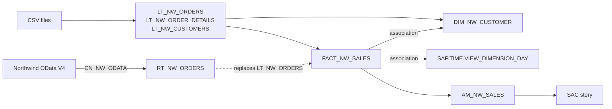

# Unit 01 — Space, first model and report, remote source

**Phase:** P0 — Tenant & governance setup (also a first thin slice through P1 ingestion, P2
transformation, P3 semantic layer and P6 consumption) · **Builds on:** — · **Status:**
in progress

> **⚠ verify** marks steps written from general product knowledge that may differ in your
> tenant's version or licence. Report any deviation and I'll correct the text.

## Course objective

Go once through the whole chain on a small scale: create a space, load files, build a first
view, report on it in SAC, then swap a local table for a remote one and add a time
dimension and associations. See [`syllabus.md`](../../syllabus.md) for the objectives in my
words. The parts below follow the course order.

## Concepts

| Concept | What to understand | Why it matters here |
| ------- | ------------------ | ------------------- |
| **Space** | The unit of isolation in Datasphere: own objects, own storage quota, own members and connections. Objects are invisible to other spaces unless shared. | Everything in this project lives in a space; governance (P0, P4) starts here. |
| **Global vs. scoped roles** | Global roles (e.g. *DW Administrator*) grant tenant-wide privileges such as creating spaces; scoped roles grant privileges only inside the spaces they are scoped to. | Decides whether you can create your own space or must work in one prepared for you. |
| **Local table** | Table whose data is stored in Datasphere (here filled by a CSV import). | Persisted data: fast, independent of the source, but a copy that ages. |
| **Remote table** | A table definition pointing at a source object through a connection. Data access is *remote* (federated, read on demand) or *replicated* (copied into Datasphere). | The core federation-vs-replication trade-off of this project. Here we only use federation. |
| **Connection** | Per-space definition of how to reach a source system (type, URL, authentication). | One connection serves many remote tables and flows. |
| **Graphical view & view editor** | Canvas of nodes: sources → operators (join, union, projection, calculated columns, filter, aggregation) → output node, whose properties hold the semantic usage, measures/attributes, associations and *expose for consumption*. | The main modelling tool for P2/P3. |
| **Semantic usage** | Declares the role of a view: *Relational Dataset*, *Fact*, *Dimension*, *Text*, *Hierarchy*. A *Fact* needs at least one measure; a *Dimension* needs a key. | Decides what the view can be used for: only a Fact can feed an analytic model, only a Dimension (or Text/Hierarchy) can be an association target. |
| **Analytic model** | The consumption-ready semantic layer on top of one Fact: chosen measures, dimensions pulled in through the Fact's associations, variables. | **SAC stories consume analytic models**, not raw views (⚠ verify: older tenants may still offer the deprecated *Analytical Dataset* semantic usage). |
| **Association** | A key-based relationship from a view to a Dimension/Text/Hierarchy. Not a join: nothing is joined in the view; the analytic model and consumers resolve it only when its attributes are requested. | Keeps the fact narrow and reuses dimensions; the basis of the star schema. |
| **Time dimension** | Generated per space: a time table plus day/week/month/quarter/year dimension views (`SAP.TIME.*`). | Consistent time analysis and a Year → Quarter → Month → Day drill without hand-built date tables. |
| **Expose for consumption** | Switch on a view that makes it consumable by external tools (Power BI, ODBC/OData clients). | Not needed for SAC via an analytic model, but needed for Power BI later (P6). |

### Federation vs. replication, in one paragraph

A remote table in *remote* mode sends every query to the source: always fresh, no storage
used, but speed and availability depend on the source and the network, and not every
operation can be pushed down. *Replicated* mode copies the data and serves queries locally.
This unit swaps a local table for a remote one in an existing model to show that the model
doesn't care which one is underneath. The decision of which mode to use per table is
revisited in P1.

## Exercise

Build **Northwind Sales** as a first star-schema slice, in the course order:

- **A. Space** — your own space `NW_LAB`.
- **B. First model** — three CSV files into local tables; a graphical **fact view** of
  order lines with `REVENUE = UnitPrice × Quantity × (1 − Discount)`.
- **C. First report** — a minimal analytic model and a SAC story of revenue by ship
  country.
- **D. Remote source** — an OData connection to the public Northwind service; replace
  `LT_NW_ORDERS` by the remote table `RT_NW_ORDERS`; story totals unchanged.
- **E. Time dimension and associations** — generate the time dimension, add a customer
  dimension, associate both to the fact and use them in the story.

Objects created (see [`docs/naming.md`](../../docs/naming.md)):

| Technical name | Type | Business name | Part |
| -------------- | ---- | ------------- | ---- |
| `NW_LAB` | Space | Northwind Lab | A |
| `LT_NW_CUSTOMERS` | Local table | Northwind Customers (file) | B |
| `LT_NW_ORDERS` | Local table | Northwind Orders (file) | B |
| `LT_NW_ORDER_DETAILS` | Local table | Northwind Order Details (file) | B |
| `FACT_NW_SALES` | Fact view | Sales | B |
| `AM_NW_SALES` | Analytic model | Sales Analysis | C |
| `CN_NW_ODATA` | Connection | Northwind OData V4 | D |
| `RT_NW_ORDERS` | Remote table | Northwind Orders (remote) | D |
| `SAP.TIME.*` | Time dimension (generated) | — | E |
| `DIM_NW_CUSTOMER` | Dimension view | Customer | E |



### Prerequisites

- Access to the tenant. Creating a space needs the tenant-wide *create space* privilege,
  normally only in the global role **DW Administrator** (⚠ verify: a *DW Space
  Administrator* manages spaces it is scoped to but usually cannot create new ones). **If
  you can't create a space**, either ask the trainer to create `NW_LAB` and add you, or work
  in the trainer's `Lab` space; skip steps 3–5 and report it so the decision is logged.
- The three CSV files. Generate them locally from the public service (no manual download):

  ```powershell
  python scripts\export_northwind.py
  ```

  This writes `customers.csv` (91 rows), `orders.csv` (830) and `order_details.csv` (2,155)
  into `data\raw\`. Dates are exported as `YYYY-MM-DD`.
- SAC with a live connection to this Datasphere tenant, created by a SAC admin
  (⚠ verify: ask the trainer whether it exists and what it is called).

### Steps

Condensed, reproducible steps. The build itself was run from a click-level private guide
with comprehension checks after each part.

#### A. Space

> **As executed:** the training tenant reserves space creation for the trainer, so this
> unit runs in the trainer-provided shared space inside a folder `NW_LAB` (see
> `docs/decisions.md`). Steps 3–5 are kept as the procedure for an own space.

1. **Check your access.** Open *Space Management* and see whether *Create* is offered. Check
   your roles in your user profile (⚠ verify: or *Security → Users*). Note both in
   **Results**: they decide the rest of part A.
2. **Inspect the trainer's `Lab` space.** Look at its members (and their scoped roles),
   storage assignment and connections. This is the reference for your own space.
3. **Create the space.** *Space Management → Create*: space name `Northwind Lab`, space ID
   `NW_LAB` (max 20 characters, upper case; add a suffix if taken). Storage type
   *SAP HANA Database (Disk and In-Memory)* (⚠ verify: the alternative is a file space on
   the object store, used with BDC later).
4. **Assign storage.** Keep the space quota small, e.g. 2 GB disk and 1 GB in-memory
   (⚠ verify: defaults and minimums depend on tenant size). *Why:* quotas come out of one
   tenant-wide pool; over-allocating in a shared training tenant blocks other trainees.
5. **Add members and deploy.** Add yourself with a scoped role that allows modelling in
   this space (⚠ verify: e.g. *DW Modeler* scoped to `NW_LAB`). *Deploy* the space.
6. **Tour the space settings** you'll use later, without changing them: *Members*, *Time
   Data*, *Connections* (or *Connections* in the left menu), *Data Access Controls*,
   *Auditing*, *Database Access* (database users, used for Power BI in P6).

#### B. First model: CSV → local tables → graphical view

7. **Import `customers.csv`.** *Data Builder* → *Import → Import CSV File* → *Select
   Source File* → *Use first row as column header*, delimiter auto-detect → *Upload*. In
   the side panel open each column's *Details*: the importer offers only *Boolean,
   Integer, Number (Decimal(38,19)), String (String(5000)), Date, Time, Date and Time*.
   Set **`PostalCode` to String** (values like `05021` would lose the leading zero) and
   **Set as Key** on `CustomerID`. *Deploy* as `LT_NW_CUSTOMERS`.
8. **Import `orders.csv`** as `LT_NW_ORDERS`: key `OrderID`; `OrderDate`, `RequiredDate`,
   `ShippedDate` as **Date** (21 orders have no `ShippedDate`: nulls are expected);
   `Freight` as **Number**, never *REAL* (binary floating point: `1.1` becomes
   `1.100000023841858`).
9. **Import `order_details.csv`** as `LT_NW_ORDER_DETAILS`: keys `OrderID` + `ProductID`;
   `UnitPrice` and `Discount` **Number**, `Quantity` Integer.
10. **Check the tables.** Open each in the table editor (keys, types) and *Preview Data*.
    Row counts in *Monitoring → Data Integration → Local Tables*: 91, 830 and 2,155.
11. **Build the fact view.** *Data Builder → New Graphical View*:
    1. Drag `LT_NW_ORDER_DETAILS` from the *Source Browser* onto the canvas; an output node
       is created automatically.
    2. Drop `LT_NW_ORDERS` onto that node (it turns green) to create a **Join**: *Inner*,
       cardinality `MANY TO ONE`, mapped on `OrderID`. Datasphere adds a **Projection**
       after the join to remove duplicate columns; exclude the columns not needed there.
    3. Add a **Calculated Columns** node: `REVENUE` = `"UnitPrice" * "Quantity" *
       (1 - "Discount")` (Decimal 15,2) and `ORDER_DATE` = `TO_DATE("OrderDate")` (Date).
       *Why `ORDER_DATE`:* `TO_DATE` works on both a date and a timestamp, so the source
       swap in part D (OData returns a timestamp) needs no change in the view.
    4. Output node: technical name `FACT_NW_SALES` (fixed once saved), semantic usage
       **Fact**; *Change to Measure* on `REVENUE` and `Quantity` (aggregation SUM).
       *Expose for Consumption* stays off: an analytic model doesn't need it.
    5. Save and deploy. Each source or join takes at most one *Filter*, *Projection*,
       *Calculated Columns* and *Aggregation* node.
12. **Learn the editor.** *Preview Data* on every node (the join must still return
    2,155 rows), *Preview SQL* from the preview panel, *Impact and Lineage Analysis*, and
    a temporary *Filter* (`"ShipCountry" = 'Germany'`) that is removed again so totals
    stay comparable in part D.

#### C. First report: analytic model and SAC story

13. **Create the analytic model.** *Data Builder → New Analytic Model* → drag
    `FACT_NW_SALES` from the repository (only facts and analytic models are offered). Keep
    measures `REVENUE`, `Quantity` and dimensions `ShipCountry`, `CustomerID`,
    `ORDER_DATE` (fact attributes are called *dimensions* in the analytic model). Name
    `AM_NW_SALES`, save, deploy. In the analytical preview the totals are `Quantity` =
    **51,317** and `REVENUE` = **1,265,792.64** (each line truncated to 2 decimals; the
    exact sum is 1,265,793.04, see *Gotchas*).
    *Why an analytic model:* it is the object SAC reads; it decides which measures and
    dimensions consumers see.
14. **Create the story.** In SAC: *Main Menu → Stories → Canvas* → *Add New Data* → the
    SAP Datasphere live connection → the space → `AM_NW_SALES`. Consuming Datasphere
    data in stories requires the *DW Consumer* role in Datasphere.
15. **Chart: revenue by ship country.** Bar/column chart, measure `REVENUE`, dimension
    `ShipCountry`; *More Actions → Rank → Top N* (10), which also sorts.
16. **Numeric points** for total `REVENUE` and `Quantity` (ranking isn't available for
    this chart type). Record both totals: they must match step 13 and are the reference
    for part D.
17. **Save** as `Northwind Sales Overview`.

#### D. Remote source: connection and remote table

18. **Create the connection.** In `NW_LAB` → *Connections → Create → Generic OData*. URL
    `https://services.odata.org/V4/Northwind/Northwind.svc/`, version **V4**,
    authentication *No Authentication*, no Cloud Connector. Technical name `CN_NW_ODATA`.
    Save and **Validate**. ⚠ verify: tenants can block outbound calls to public hosts; if it
    fails, try the V2 URL `https://services.odata.org/V2/Northwind/Northwind.svc/` and
    record the error either way.
19. **Read the connection's feature list** (remote tables, data flows, replication flows)
    and note which are supported for Generic OData.
20. **Import the remote table.** *Data Builder → Import → Remote Tables* (⚠ verify: or
    *Sources* tab in the editor) → `CN_NW_ODATA` → entity `Orders` → rename to
    `RT_NW_ORDERS` → import and deploy. Data access stays **Remote**. Preview: 830 rows.
21. **Compare with the local table.** The remote table has more columns (`ShipName`,
    `ShipAddress`, …) and `OrderDate` as a **timestamp**, the local one as a date.
22. **Replace the source.** Open `FACT_NW_SALES`, drag `RT_NW_ORDERS` onto the
    `LT_NW_ORDERS` node and choose **Replace** (⚠ verify: drop menu offers Join / Union /
    Replace). Check the column mapping (same names → automatic), save, deploy. `ORDER_DATE`
    keeps working thanks to `TO_DATE`.
23. **Re-test.** Refresh the story: totals must equal the ones from step 16. Compare
    response time; check *Lineage* of the view to see the remote source.
24. **Look at, don't change, data access.** In `RT_NW_ORDERS` look at the *Data Access* /
    replication options (⚠ verify: snapshot only for Generic OData). This is P1 material.

#### E. Time dimension and associations

25. **Generate the time dimension.** *Space Management → `NW_LAB` → Time Data → Create
    Time Tables and Dimensions*. Years **1996 to 1999** (orders run 1996-07 to 1998-05).
    Create.
26. **Find the generated objects** in the Data Builder: the table
    `SAP.TIME.M_TIME_DIMENSION` and views `SAP.TIME.VIEW_DIMENSION_DAY/WEEK/MONTH/QUARTER/YEAR`
    (⚠ verify names). Preview the day view: key `DATE_SQL`, attributes for year, quarter,
    month, and a Year → Quarter → Month → Day hierarchy.
27. **Create the customer dimension.** *New Graphical View* → `LT_NW_CUSTOMERS` → output
    semantic usage **Dimension**, key `CustomerID`, business names for attributes.
    Technical name `DIM_NW_CUSTOMER`. Deploy.
28. **Add the associations** in `FACT_NW_SALES` → output node → *Associations*:
    `CustomerID` → `DIM_NW_CUSTOMER.CustomerID`, and `ORDER_DATE` →
    `SAP.TIME.VIEW_DIMENSION_DAY.DATE_SQL`. Deploy. The fact view's own columns don't
    change: nothing was joined.
29. **Extend the analytic model.** Open `AM_NW_SALES`: the two associated dimensions now
    appear as available dimensions. Add them, selecting `CompanyName`, `City`, `Country`
    and the time attributes. Deploy.
30. **Use them in the story.** Add a time-series chart of `REVENUE` by the order-date
    dimension, drilling Year → Quarter → Month (⚠ verify: select the hierarchy in the
    chart builder). Add a bar chart of `REVENUE` by customer `Country` and compare it with
    the `ShipCountry` chart. Save.

### Acceptance criteria

- [ ] Space `NW_LAB` exists, deployed, with storage assigned and me as member, **or**
      (as executed) folder `NW_LAB` exists in the shared space, with no name collisions
      and the deviation documented.
- [ ] `LT_NW_CUSTOMERS` (91), `LT_NW_ORDERS` (830) and `LT_NW_ORDER_DETAILS` (2,155) are
      deployed with key columns, `PostalCode` as string and date/decimal types.
- [ ] `FACT_NW_SALES` (Fact, measures `REVENUE` and `Quantity`) and `AM_NW_SALES` are
      deployed and previewable.
- [ ] SAC story `Northwind Sales Overview` shows revenue by ship country and the totals
      are recorded.
- [ ] Connection `CN_NW_ODATA` validates (or the failure and the fallback are documented).
- [ ] `RT_NW_ORDERS` returns 830 rows in remote mode and replaces `LT_NW_ORDERS` in
      `FACT_NW_SALES`; story totals are identical before and after.
- [ ] Time dimension generated for 1996–1999; `FACT_NW_SALES` associates to it and to
      `DIM_NW_CUSTOMER`; both are in `AM_NW_SALES`.
- [ ] The story drills revenue Year → Quarter → Month and shows revenue by customer
      country.
- [ ] I can explain in my own words: join vs. association, local vs. remote table, why SAC
      reads an analytic model (in **Results**).

## Results

### Part A — Space

- Worked in the trainer-provided shared space (quota enabled, 2 GB disk / 1 GB in-memory,
  deployed), inside a new Data Builder folder `NW_LAB`. Own-space creation was not used.
- The space's time data already exists with a 1900–2050 range, so it covers the Northwind
  order dates (1996–1998) and step 25 is not needed.
- A search for this project's prefixes found no technical-name collisions with the other
  trainee's objects.
- Space priority and statement limits are not on the space page in the current release:
  they are tenant-level, under *System → Configuration → Workload Management*.

### Part B — Local tables

- `LT_NW_CUSTOMERS` (91 rows), `LT_NW_ORDERS` (830) and `LT_NW_ORDER_DETAILS` (2,155)
  imported with *Import CSV File* into folder `NW_LAB`, with keys and String / Number /
  Date types as planned. Counts confirmed in *Monitoring → Data Integration → Local
  Tables*.
- `FACT_NW_SALES` deployed as a *Fact* (measures `REVENUE`, `Quantity`): inner join on
  `OrderID` returns all 2,155 lines; spot check order 10249 / product 14 = 167.40.

### Part C — First report

- `AM_NW_SALES` deployed on `FACT_NW_SALES`; analytical preview and SAC numeric points
  agree: `Quantity` **51,317**, `REVENUE` **1,265,792.64** (after fixing the `REVENUE`
  scale, see *Gotchas*).
- SAC story `Northwind Sales Overview` (live connection, private folder) with revenue by
  ship country, top 10.

## Gotchas

- The space card title in *Space Management* is not a link: open a space with the card's
  **Edit** button.
- Technical names are unique per space, folders don't create a namespace: search before
  creating objects in a shared space.
- Deleting a folder deletes its contents irreversibly; move objects out first.
- A calculated column's *Decimal* type needs an explicit **scale**: left at 0, every line's
  revenue was truncated to whole units (total 1,265,326 instead of ~1,265,793). Spot-check
  calculations on a value that has decimals.
- *Validate* on a calculated column re-derives its data type from the expression and
  overwrites a manually set precision/scale: validate first, then set the type.
- Reducing scale **truncates** (163.625 → 163.62); use `ROUND(…, 2)` when cent rounding is
  wanted.

## Link to next unit

Leaves in place: a working space, one connection, a minimal star schema, a time dimension,
an analytic model and a first story. Later units deepen each slice: P1 ingestion modes
(replication vs. federation, data flows), P2 transformation and quality, P3 text and
hierarchies and the full analytic model.
